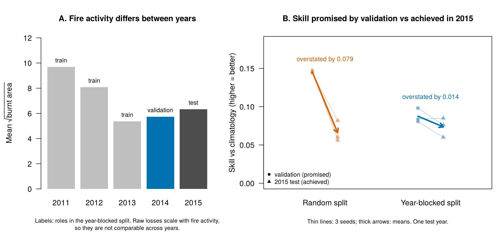
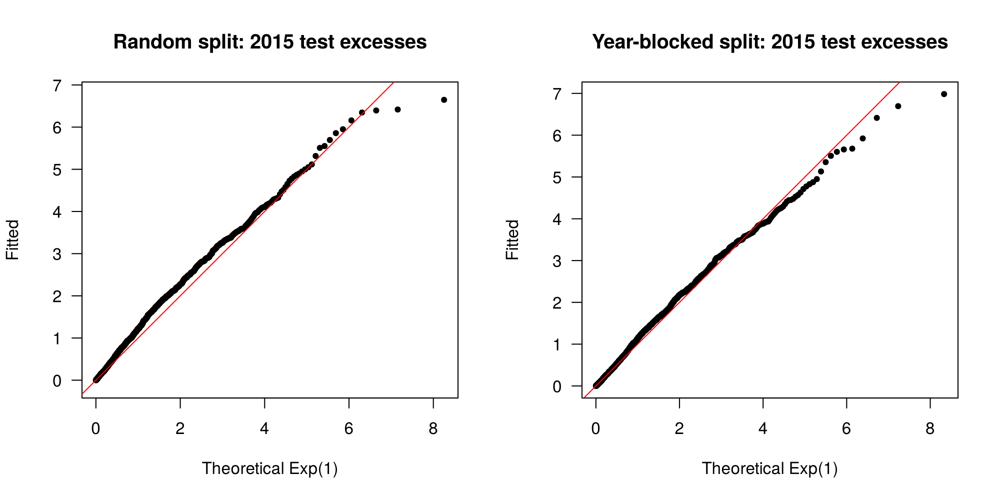

# AI and extremes: worked notebooks and a validation extension

This repository is a **fork** of [Jbrich95/CASE2025_shortcourse](https://github.com/Jbrich95/CASE2025_shortcourse), the materials for the short course *AI and extremes* by **Likun Zhang** (University of Missouri), **Jordan Richards** (University of Edinburgh) and **Reetam Majumder** (University of Arkansas), taught at the CASE 2025 extremes workshop.

The original slides, R Markdown files and data are unchanged at the top level of this repository. The `my-work/` folder contains:

* the three course notebooks, converted to **Google Colab** notebooks with explanations added, and
* **one extension of my own** (Notebook 04), which tests how much random-split validation flatters deep extreme-value models fitted to spatio-temporal data.

*Main result of the extension (Notebook 04). **A:** fire activity varies strongly between years, so raw losses cannot be compared across years. **B:** on a scale-free skill score, random-split validation promised about twice the skill the model achieved on the unseen year 2015; year-blocked validation was close. 3 seeds, one test year.*

All credit for the course content, code and data belongs to the original authors. The original repository has no licence file, so its materials remain the authors' own; this fork is shared for learning, with attribution, and will be changed or removed on request.

---

## Contents

| Notebook | Content | Open |
|---|---|---|
| [`01_deep_GPD_regression_wildfires.ipynb`](my-work/01_deep_GPD_regression_wildfires.ipynb) | Deep quantile regression with the pinball loss, then deep generalised Pareto (peaks-over-threshold) regression for US wildfire burnt area; three models for the shape parameter ξ; LIME interpretation |  |
| [`02_SPQR_density_regression.ipynb`](my-work/02_SPQR_density_regression.ipynb) | Semi-parametric quantile regression (SPQR): whole conditional densities as neural-network-weighted M-spline mixtures |  |
| [`03_neural_Bayes_estimator.ipynb`](my-work/03_neural_Bayes_estimator.ipynb) | A simulation-trained, amortised neural Bayes estimator for Hüsler–Reiss extremal dependence, applied to annual temperature maxima |  |
| [`04_extension_blocked_vs_random_validation.ipynb`](my-work/04_extension_blocked_vs_random_validation.ipynb) | **Extension:** random vs year-blocked validation of the Notebook 01 pipeline, compared like-for-like on a held-out year |  |

**To run:** click a badge, choose *Runtime → Change runtime type → R* (CPU is enough), then *Runtime → Run all*. Each notebook installs its R packages and downloads its data from the original repository. Notebooks 01–03 take roughly 5–30 minutes on a CPU; Notebook 04 takes about 25–60 minutes with its default of three seeds.

---

## Changes to the course code

The course code is kept as written, apart from changes needed to run it as a standalone Colab notebook. Each change is marked **[Adapted]** in the notebooks.

* A setup cell that works both on Colab and locally, downloads the data, and creates the `checkpoints/` folder the callbacks write to.
* Hidden chunks that only work on the authors' machines (a local virtualenv, and a `../WACE_shortcourse/` data path) are removed.
* The LIME methods are registered for whatever class name the installed Keras version gives the model, instead of a hard-coded class name.
* In the SPQR notebook, the input size is passed to `keras_model_sequential()` rather than to a layer, as Keras 3 recommends.
* In the neural-estimator notebook, a check that the real data have exactly the 64 replicates the network was trained for.

Explanation cells add the reasoning behind each step, and **validation notes** point out evaluation shortcuts that are reasonable for teaching but optimistic in real applications:

1. Train/test rows are sampled at random, although neighbouring cells in the same month are strongly dependent.
2. Covariates are standardised before splitting.
3. The GPD models are compared on the test set, and Model 3 reuses the σ-branch already trained inside Model 2.
4. In Notebook 02, the response is rescaled using the range of all the data, test rows included, and daily observations are split at random despite temporal dependence. The "marginal" density is averaged over a uniform grid of precipitation rather than its observed distribution.
5. In Notebook 03, the evaluation uses fresh simulations and is clean. The limitations are architectural: the network accepts a fixed sample size and is not permutation-invariant.

These shortcuts are kept as the course wrote them, so Notebooks 01–03 stay faithful to the original. Notebook 04 fixes the Notebook 01 issues in its own pipeline (training-only scaling, model choice on validation, no warm starts, an untouched test year).

---

## Extension: how optimistic is random-split validation for spatio-temporal extremes?

### Motivation

Deep extreme-value models are often validated with random train/validation/test splits. For spatio-temporal data, neighbouring observations share the same weather, so a randomly held-out point usually has near-duplicates in the training set. The validation score then measures how well the model **fills gaps in periods it has already seen**, not how it performs **in a new period**, which is what matters for risk assessment.

### Design

* **One test year shared by both schemes:** all positive cells in **2015**. It is never used for training, scaling, early stopping or model selection.
* **Random scheme:** cell-months from 2011–2014 split at random into training and validation.
* **Blocked scheme:** training = 2011–2013, validation = 2014.
* The schemes use identical training and validation **sizes**, architectures, losses and hyperparameters (those of Notebook 01). Only the split differs.
* Covariates are standardised with **training rows only**. The threshold model, the three GPD models, early stopping and the choice between GPD models all use the **validation** set; 2015 is used once, at the end.
* Every network is built from scratch. The whole pipeline is repeated over **3 seeds**.

### Metrics

* **Pinball loss** of the τ = 0.85 threshold model on validation (the estimate) and on 2015 (the actual result). Both schemes are evaluated on the same 2015 rows, so their 2015 pinball losses can be compared directly.
* **Non-exceedance rate** P(Y < û(x)), which should be close to τ = 0.85.
* **Mean GPD negative log-likelihood per excess** for the GPD model chosen on validation. Each scheme has its own threshold and therefore its own excesses, so this is compared within a scheme (validation vs 2015) only.

### Results

From the verification run of Notebook 04: 3 seeds per scheme, R + `keras3` on TensorFlow 2.21, CPU. Values are means, with standard deviations over seeds in brackets. A Colab run may give slightly different numbers.

**1. Raw losses are misleading here.** Fire activity varies a lot between years: 2011 and 2012 were far more active than 2013–2015. Raw pinball loss scales with burnt area, so the blocked scheme, which validates on the quiet year 2014, appears to *under*-estimate its 2015 loss. The random scheme, which validates on a mix that includes the big years, appears to *over*-estimate it. Neither pattern says anything about leakage.

**2. On a scale-free skill score** (1 − model loss / climatology loss, with climatology = the unconditional 0.85-quantile of the training responses):

| | Random split | Year-blocked split |
|---|---|---|
| Skill promised by validation | 0.145 (0.002) | 0.088 (0.009) |
| Skill achieved in 2015 | 0.066 (0.014) | 0.074 (0.013) |
| **Overstatement of skill** | **0.079 (0.015)** | **0.014 (0.013)** |

Random-split validation promised more than **twice** the skill the threshold model achieved on the unseen year. Year-blocked validation was close. The difference in overstatement was 0.063–0.069 in every seed.

**3. The models themselves performed about the same in 2015.** The 2015 pinball loss was 3.304 (blocked) vs 3.309 (random); the paired difference was 0.005, with p = 0.83 over 3 seeds. Blocking gave a much **more honest estimate**, not a better model.

**4. Calibration.** Both threshold models slightly under-cover in 2015: non-exceedance was 0.81 (blocked) and 0.80 (random), against a target of 0.85. This is consistent with year-to-year **distribution shift**.

**5. Tail fit on 2015 (seed 1, QQ plots above).** The blocked scheme's chosen GPD model follows the diagonal through the body of the excess distribution. The random scheme's sits above it, meaning its fitted scales are too small for 2015. For both, the ten or so largest excesses fall below the line: the fitted upper tail is slightly heavier than what 2015 showed.

**6. Model choice is unstable.** Under blocked validation, the fully flexible GPD model (Model 1) was chosen in 3/3 seeds. Under random validation, the constant-ξ model (Model 3) was chosen in 2/3 seeds.

The one-sample t-tests in the notebook reflect **training randomness across seeds only**. There is one test year, so these numbers show the size of the effect in one setting; they do not establish it in general.

### Analysis history and limitations

* **The skill score was chosen after seeing the first results.** The pre-planned comparison used raw validation-vs-test loss gaps. Those gaps turned out to be dominated by year-to-year differences in fire activity (Panel A), so the scale-free skill score was added afterwards. The raw results are still reported in the notebook alongside the skill scores. Because the metric was chosen after seeing the data, the skill comparison should be read as exploratory and confirmed on new data.
* **"Promised" scores include selection bias.** The validation set is also used for checkpointing, early stopping and choosing between the three GPD models, so validation scores are somewhat optimistic in *both* schemes. That is how validation scores are usually reported in practice, which is what this experiment mimics, but part of each overstatement is selection rather than the split. A separate held-out estimation set would remove it.
* **Different sources of variation.** The random scheme draws a new split for each seed, while the blocked split is fixed. The random scheme's spread across seeds therefore includes split randomness, and the blocked scheme's does not.
* **Contemporaneous covariates.** The covariates are same-month weather and land cover, none derived from burnt area, so there is no target leakage. They are, however, not known in advance, so this is explanatory regression, not forecasting.
* One validation year and one test year of 7 months each: estimates are noisy, and 2015 may be an unusual fire year. Leave-one-year-out cross-validation over all five years would be more reliable.
* Only temporal blocking is used. Spatial blocking, or holding out whole fire events, would be the next step.
* Three seeds show training randomness; they do not give strong statistical evidence.
* The architectures and hyperparameters were taken from the course without retuning for either scheme.

### Relevance

The same issue appears in the evaluation of **generative models for rainfall extremes**. A model can look excellent on randomly held-out fields from storms it has already seen yet assign the wrong probabilities to new, more severe events. Holding out **whole storms, years or ensemble members**, and separating visual realism from correct tail probabilities, is part of the validation plan in the University of Edinburgh / Met Office E5 project *Stochastic generation of realistic UK rainfall extremes via generative AI*.

---

## Software

The notebooks were tested end to end with R and `keras3` on TensorFlow 2.21 (CPU). On Colab, package versions may differ, and results can vary slightly between machines even with fixed seeds.

## Acknowledgements and references

* Course materials: L. Zhang, J. Richards and R. Majumder, *AI and extremes*, CASE 2025 short course. [github.com/Jbrich95/CASE2025_shortcourse](https://github.com/Jbrich95/CASE2025_shortcourse)
* Richards, J. and Huser, R. *Extreme quantile regression with deep learning.* In *Handbook on Statistics of Extremes*, Chapman & Hall/CRC.
* Richards, J. and Huser, R. (2026). Regression modelling of spatiotemporal extreme U.S. wildfires via partially-interpretable neural networks. *Journal of Computational and Graphical Statistics*, 35(3), 1205–1220.
* Xu, S. G., Majumder, R. and Reich, B. J. (2022). SPQR: an R package for semi-parametric density and quantile regression. arXiv:2210.14482.
* Majumder, R. and Richards, J. (2026). Semi-parametric bulk and tail regression using spline-based neural networks. *Extremes*, 29, 245–277.
* Sainsbury-Dale, M., Zammit-Mangion, A. and Huser, R. (2024). Likelihood-free parameter estimation with neural Bayes estimators. *The American Statistician*, 78(1), 1–14.
* Richards, J., Sainsbury-Dale, M., Zammit-Mangion, A. and Huser, R. (2024). Neural Bayes estimators for censored inference with peaks-over-threshold models. *Journal of Machine Learning Research*, 25(390), 1–49.
